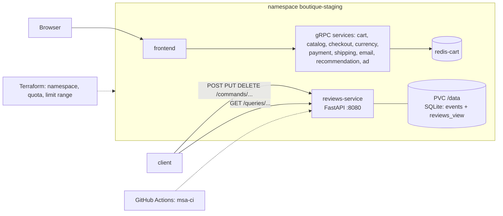

# Design, Deployment and Evolution of a Kubernetes-Orchestrated Polyglot E-Commerce Microservices Architecture Using gRPC, IaC and DevOps Pipelines

Course project for **Microservices Architecture (IS373TA)**. A polyglot e-commerce system runs on a local Kubernetes cluster (minikube), extended with our own event-sourced **reviews-service**, an OpenAPI contract, kustomize deployments, Terraform infrastructure, a CI pipeline and design documentation.

Everything runs locally and for free: no cloud account, no secrets.

## Architecture



The shop consists of 12 workloads written in several languages that talk gRPC, defined in `protos/demo.proto`. `reviews-service` is independent: it owns its data, is not called by the frontend, and shares only a `product_id` string convention with the catalog.

## What this project demonstrates

| # | Concept | Where |
|---|---|---|
| 1 | Microservices, coordination costs, decisions | `msa/docs/01-architecture-overview.md` |
| 2 | Operating model, Team Topologies | `msa/docs/02-team-topology.md` |
| 3 | SEED(S): actors, jobs-to-be-done, sequence diagrams, actions and queries | `msa/docs/03-seeds-process.md` |
| 4 | Query/action specification with an open standard | `msa/api/reviews-openapi.yaml`, `protos/demo.proto` |
| 5 | Service boundaries: DDD, event storming, sizing | `msa/docs/04-event-storming-ddd.md` |
| 6 | Data embedded per service, independent deployability | `msa/docs/05-data-and-cqrs.md`, `msa/services/reviews-service` |
| 7 | Event Sourcing and CQRS | `msa/services/reviews-service/app/`, `tests/` |
| 8 | DevOps and Infrastructure as Code | `msa/iac/staging/`, `.github/workflows/msa-ci.yaml` |
| 9 | Containerised workspace, local Kubernetes, umbrella project | `Dockerfile`, `docker-compose.yml`, `msa/deploy/`, `run.bat` |
| 10 | Releasing to staging, managing change | `boutique-staging` namespace, `msa/scripts/rollout_demo.bat`, `msa/docs/06-managing-change.md` |
| + | Measuring complexity and progress | `msa/docs/07-complexity-and-progress.md` |

Not covered: Cassandra and AWS-specific setup.

## The reviews-service

Python 3.12, FastAPI, SQLite on a persistent volume.

- **Commands (write side):** `POST /commands/reviews`, `PUT /commands/reviews/{id}`, `DELETE /commands/reviews/{id}`. Each validates, appends an event (`ReviewSubmitted`, `ReviewEdited`, `ReviewRemoved`) and updates the projection in one transaction.
- **Queries (read side):** `GET /queries/products/{product_id}/reviews` and `GET /queries/products/{product_id}/rating-summary`.
- **Operations:** `/healthz`, `/version`, `/events` (audit log) and `POST /admin/rebuild-projection`, which drops the read model and rebuilds it by replaying every event.

The event table is append-only (enforced by database triggers), so the current state can always be reconstructed from history.

## Quick start (Windows)

Needs Windows 10/11, Docker Desktop (about 5 GB memory) and internet for the first run.

```
run.bat            start minikube and deploy the shop plus reviews-service into boutique-staging
run.bat demo       rolling update 1.0.0 to 1.1.0, then rollback
run.bat stop       stop port-forwards and minikube
run.bat clean      delete the minikube cluster
```

When it finishes:

- Shop: http://localhost:8080
- reviews-service: http://localhost:8081 (`/docs` for the interactive API)

`run.bat` installs missing tools through winget and asks you to reopen the terminal if it did. The first run takes 10 to 20 minutes because images are downloaded.

Service only, without a cluster:

```
cd msa\services\reviews-service
pip install -r requirements-dev.txt
pytest
python smoke_test.py http://localhost:8080   (with the service running)
```

## Repository layout

| Path | Content |
|---|---|
| `msa/services/reviews-service/` | the service, tests, Dockerfile, compose file, smoke test |
| `msa/api/` | OpenAPI contract |
| `msa/deploy/` | kustomize base with dev and staging overlays |
| `msa/iac/staging/` | Terraform: namespace, ResourceQuota, LimitRange |
| `msa/scripts/` | rolling update and rollback demo |
| `msa/docs/` | design documents 01 to 07 |
| `.github/workflows/msa-ci.yaml` | pytest, docker build, kustomize render, terraform checks, kind smoke test |
| `run.bat` | one-click setup and run |
| `src/`, `protos/`, `release/` | the base shop (see Acknowledgements); the frontend footer, fonts and cloud label were customised |

## Verification status

Also see `msa/EVIDENCE.md` for the exact commands and `msa/VIVA_NOTES.md` for exam preparation.

- **Verified:** 18 pytest tests pass, the smoke test passes against a local server, the OpenAPI file is generated from the code, `kubectl kustomize` renders both overlays, `terraform fmt` passes.
- **Not yet verified:** `terraform validate` (provider download failed twice), the cluster deployment through `run.bat`, the rollout demo, the CI workflow on GitHub.

## Known limitations

- `reviews-service` uses a single replica with the `Recreate` strategy because SQLite sits on one volume, so a rollout has a brief downtime.
- The GitHub Actions workflow only runs when the repository is pushed to GitHub.

## Acknowledgements

The base shop is the open-source [Online Boutique](https://github.com/GoogleCloudPlatform/microservices-demo) sample, licensed under Apache 2.0 (see `LICENSE`). Its copyright notices are kept in the source files. The reviews-service, deployment, infrastructure, pipeline and documentation described above are our own work.
