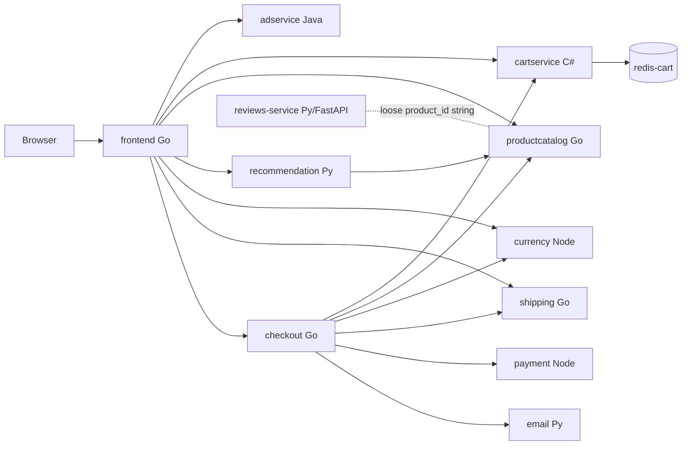

# 01 - Architecture Overview

## What Online Boutique is
Google's open-source cloud-native demo shop: a web storefront where users browse products, add to cart and check out. The release manifest (`release/kubernetes-manifests.yaml`) deploys 12 workloads: 10 application services (`frontend` plus nine gRPC backends: `adservice`, `cartservice`, `checkoutservice`, `currencyservice`, `emailservice`, `paymentservice`, `productcatalogservice`, `recommendationservice`, `shippingservice`), the `loadgenerator` (Locust traffic) and `redis-cart` (Redis). `src/shoppingassistantservice` exists in the source tree but is NOT a Deployment in the release manifest; the frontend only has an env var pointing to `shoppingassistantservice:80` (an optional add-on, Python + AlloyDB vector store). Services talk gRPC using one shared contract, `protos/demo.proto` (9 gRPC services, 15 RPCs).

Our addition is `reviews-service` (Python/FastAPI, REST, port 8080), deployed separately into namespace `boutique-staging`.

## Polyglot map

| Service | Language (from source/Dockerfile) |
|---|---|
| frontend, checkoutservice, productcatalogservice, shippingservice | Go |
| cartservice | C# (.NET) |
| adservice | Java (Gradle) |
| currencyservice, paymentservice | Node.js |
| emailservice, recommendationservice, loadgenerator, shoppingassistantservice | Python |
| reviews-service (ours) | Python / FastAPI |

Five languages (Go, C#, Java, Node.js, Python) coexist because the contract is the proto file, not a shared library.

(The dotted line is a naming convention only; reviews-service makes no calls to other services. The edges above are the main ones, not an exhaustive list.)

## Coordination-cost argument
In a monolith every change to checkout, catalog or ads goes through one build, one test suite and one release train; the number of people who must agree grows with team size. With per-service deployables behind a stable gRPC contract, a team can change internals, language and release cadence without asking others, as long as the contract holds. The price is paid elsewhere: network calls instead of function calls, distributed failure modes, and contract management (doc 06). Microservices trade coordination cost between teams for operational and runtime complexity; this is worthwhile when many teams change the system independently, less so for a tiny team.

## Three key architectural decisions and trade-offs
1. **gRPC + protobuf as the single inter-service contract** (`protos/demo.proto`). Pro: typed, compact, codegen in every language, clear backward-compatibility rules. Con: harder to debug than JSON/HTTP, browsers cannot call it directly (hence the frontend as gateway).
2. **Private state per service.** Cart state is in Redis (alternatives Spanner/AlloyDB), catalog is a JSON file loaded in memory. Pro: independent change and scaling. Con: no cross-service joins or ACID transactions; checkout is an orchestration with no distributed rollback (doc 03).
3. **Kubernetes as the runtime, one Deployment + Service per component.** Pro: rolling updates, self-healing, uniform deployment for polyglot services. Con: YAML and cluster operations overhead. For our service we add kustomize overlays and Terraform-managed namespace quota.

For `reviews-service` specifically: event sourcing + CQRS over embedded SQLite (doc 05) is a deliberate choice for audit history and rebuildable read models, at the cost of a single-replica service.

## How this maps to the syllabus
Microservices vs monolith, service decomposition, polyglot persistence/programming, inter-service communication (gRPC), container orchestration with Kubernetes, architectural trade-off analysis.

## Evidence in this repo
- `protos/demo.proto`
- `release/kubernetes-manifests.yaml`
- `src/shoppingassistantservice/shoppingassistantservice.py`
- `msa/services/reviews-service`, `msa/deploy/overlays/staging`
