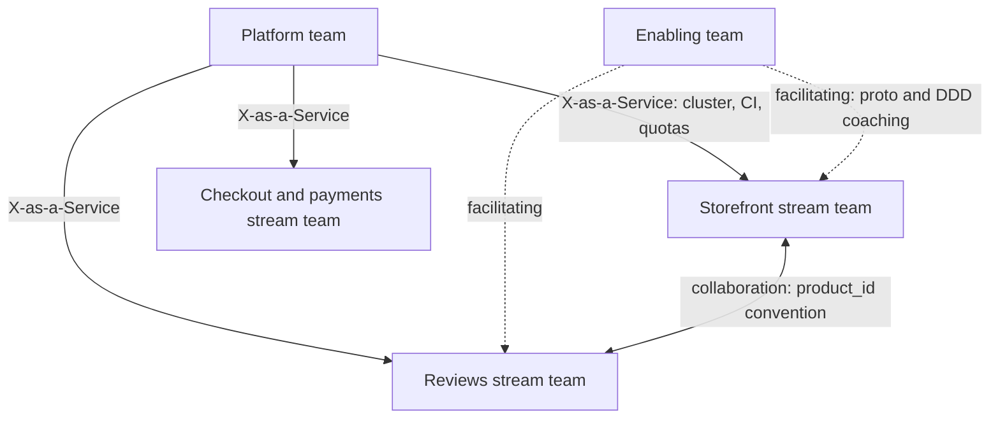

# 02 - Team Topology

Team Topologies defines team types (stream-aligned, platform, enabling, complicated-subsystem) and three interaction modes (collaboration, X-as-a-Service, facilitating). The split below is a proposed model for this codebase; the repository does not record real teams.

## Teams
- **Storefront stream team**: owns the browsing journey (frontend, catalog, ads, recommendations).
- **Checkout and payments stream team**: owns the buying journey (cart, checkout, payment, shipping, currency, email).
- **Reviews stream team** (the student's): owns `reviews-service` end to end, from API to deployment.
- **Platform team**: Kubernetes manifests, kustomize base/overlays, Terraform (namespace, ResourceQuota, LimitRange), CI pipeline, `loadgenerator`, `redis-cart`.
- **Enabling team**: coaches stream teams on proto evolution, event storming, observability; time-boxed, owns no services.

## Service-to-team mapping

| Service | Team | Why |
|---|---|---|
| frontend | Storefront | Renders every journey; consumer of all backends |
| productcatalogservice | Storefront | Product data, read-heavy |
| adservice | Storefront | Contextual ads on pages |
| recommendationservice | Storefront | Related products, calls catalog |
| shoppingassistantservice (not in release manifest) | Storefront | Optional shopper-facing add-on |
| cartservice | Checkout and payments | Cart is the first step of buying |
| checkoutservice | Checkout and payments | Orchestrates the purchase |
| paymentservice | Checkout and payments | Charges cards; candidate for a complicated-subsystem team if compliance grows |
| shippingservice | Checkout and payments | Quote and ship |
| currencyservice | Checkout and payments | Money conversion used by checkout and frontend |
| emailservice | Checkout and payments | Order confirmation |
| reviews-service | Reviews | New bounded context (doc 04) |
| redis-cart, loadgenerator | Platform | Shared infrastructure / tooling |

## Interaction modes in practice
- Reviews <-> Storefront: **collaboration** while product pages start showing reviews (the existing frontend is not wired to `reviews-service` in this repo), then X-as-a-Service through the published contract `msa/api/reviews-openapi.yaml`.
- Platform -> all: **X-as-a-Service** (a team consumes a namespace, quota and pipeline without asking).
- Enabling -> streams: **facilitating**, temporary.

Conway's law reasoning: one service per bounded context keeps each team's cognitive load at one or two services.

## How this maps to the syllabus
Organisation and team structure for microservices, Conway's law, platform engineering, ownership boundaries.

## Evidence in this repo
- `release/kubernetes-manifests.yaml` (service list)
- `msa/deploy/overlays/staging`, `msa/iac/staging`, `.github/workflows/msa-ci.yaml` (platform-owned artefacts)
- `msa/api/reviews-openapi.yaml` (published contract of the Reviews team)
