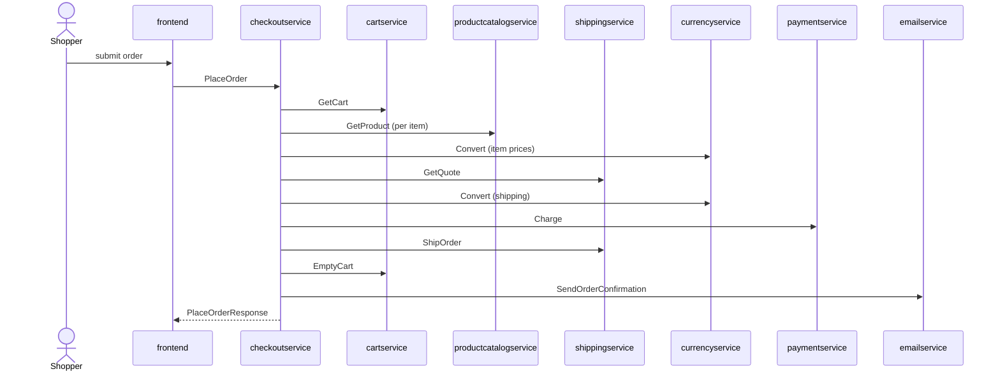
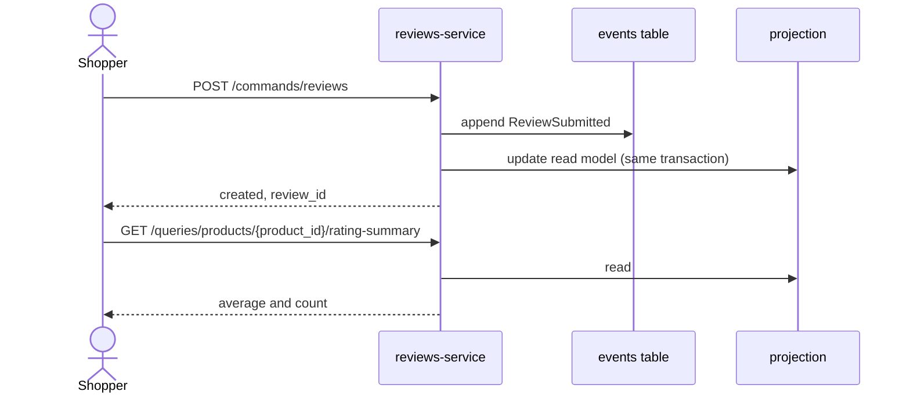

# 03 - SEED(S) Process

Steps used: identify stakeholders/actors, extract jobs-to-be-done, explore the interaction as sequences, derive actions and classify them as commands (change state) or queries (read state), then shape them into service interfaces.

## (a) Checkout flow (existing system)
**Actors:** shopper, frontend, checkoutservice and its downstream services.
**Job-to-be-done:** "I want to pay for what is in my cart and get it shipped, with a confirmation."

Flow taken from `src/checkoutservice/main.go` (`PlaceOrder`) and `protos/demo.proto`:

**Actions derived**
- Commands (change state): PlaceOrder, AddItem, EmptyCart, Charge, ShipOrder, SendOrderConfirmation.
- Queries (read only): GetCart, GetProduct, ListProducts, SearchProducts, GetQuote, Convert, GetSupportedCurrencies, ListRecommendations, GetAds.

Observation: this is a synchronous orchestration. I found no refund or cancel RPC in the proto, so if a step after `Charge` fails there is no compensation (not verified beyond reading `main.go`).

## (b) Reviews (new service)
**Actors:** shopper (writes, edits, removes own review), any visitor (reads reviews), operator (health, rebuild).
**Jobs-to-be-done:**
1. "I want to share my opinion of a product."
2. "I want to correct or withdraw my review."
3. "I want to see what others think and the average rating before buying."
4. "As an operator I want to inspect history and repair derived data."

**Derived actions**

| Action | Kind | Route | Event |
|---|---|---|---|
| Submit review | command | POST /commands/reviews | ReviewSubmitted |
| Edit review | command | PUT /commands/reviews/{review_id} | ReviewEdited |
| Remove review | command | DELETE /commands/reviews/{review_id} | ReviewRemoved |
| List product reviews | query | GET /queries/products/{product_id}/reviews | none |
| Rating summary | query | GET /queries/products/{product_id}/rating-summary | none |
| Ops | ops | /healthz, /version, /events, POST /admin/rebuild-projection | none |

The `/commands` and `/queries` prefixes make the CQRS split visible in the URL space.

## How this maps to the syllabus
SEED(S) process, jobs-to-be-done, deriving service interfaces from interactions, command/query separation, orchestration vs choreography.

## Evidence in this repo
- `protos/demo.proto`, `src/checkoutservice/main.go`
- `msa/api/reviews-openapi.yaml`, `msa/services/reviews-service`
