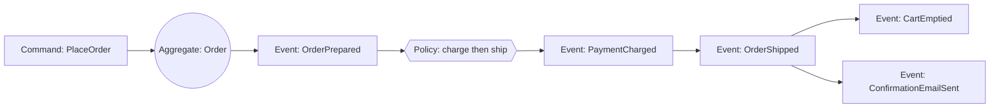
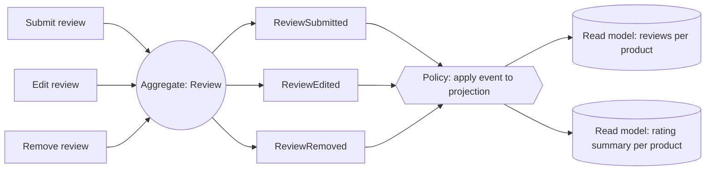
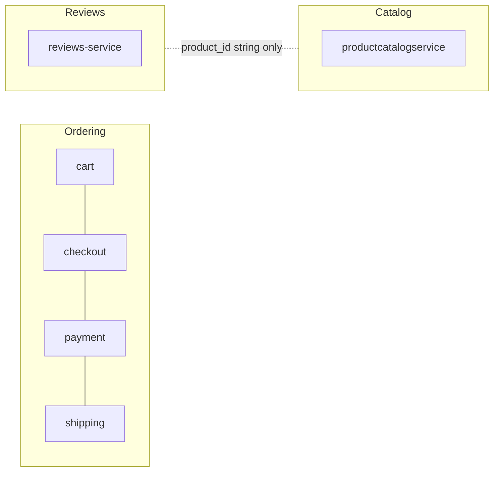

# 04 - Event Storming and DDD

Notation: command (a request to do something), event (past-tense fact), aggregate (consistency boundary), policy ("whenever X then Y"), read model (what queries need).

## Checkout (inferred from `src/checkoutservice/main.go`)

These events are conceptual: checkoutservice does not persist or publish them (I found no data store in it; the result is returned as `PlaceOrderResponse`). Other aggregates: Cart (cartservice), Product (catalog, read-only). Read models: cart view, product list.

## Reviews

- Aggregate **Review**, identified by `review_id`; edit and remove only make sense for an existing review.
- Events are stored in `events(seq, review_id, type, payload_json, created_at)`.
- Policy: every event updates the projection; `POST /admin/rebuild-projection` replays all events.
- Read models: review list and rating summary per `product_id`.

## Bounded contexts

The word "product" means different things: in Catalog it is a record with price and picture; in Reviews it is only an opaque `product_id` string. That is why no shared model or runtime call is needed.

## Why reviews is its own service
- Different data shape and write pattern (append-only user content vs a static catalog file).
- Different change rate: review features can ship without redeploying catalog or checkout.
- Failure isolation: if reviews is down, browsing and checkout still work.
- No transaction spans reviews and orders.
- Separate team ownership (doc 02).

## Sizing reasoning
One aggregate, three commands, two queries, one event table plus projection: small enough for one team to understand fully, big enough to justify its own deployment. We did not split commands and queries into two services because a SQLite file on one PVC cannot safely be written by two processes and the load does not justify it (doc 05).

## How this maps to the syllabus
Event storming, DDD (aggregates, bounded contexts, ubiquitous language), service granularity.

## Evidence in this repo
- `src/checkoutservice/main.go`, `protos/demo.proto`
- `msa/services/reviews-service`, `msa/api/reviews-openapi.yaml`
