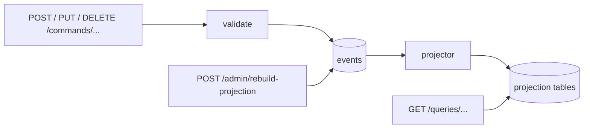

# 05 - Data Ownership, Event Sourcing and CQRS

## Data ownership (checked in code)

| Service | Data store | Notes |
|---|---|---|
| cartservice | Redis by default (`redis-cart` in the manifest, `RedisCartStore.cs`); alternatives `SpannerCartStore.cs`, `AlloyDBCartStore.cs` | Selected from config in `src/cartservice/src/Startup.cs` (`REDIS_ADDR`, `SPANNER_*`, `ALLOYDB_PRIMARY_IP`) |
| productcatalogservice | `products.json` read into memory (`catalog_loader.go`); the loader also has an AlloyDB path | Default is the local file |
| shoppingassistantservice (not in release manifest) | AlloyDB vector store (`langchain_google_alloydb_pg`) | Optional add-on |
| checkoutservice | none found | Stateless orchestrator |
| currencyservice | static data under `src/currencyservice/data` | Not inspected in detail |
| paymentservice, emailservice, shippingservice, adservice, recommendationservice | no persistent store found | Ads are in code; recommendations call the catalog |
| reviews-service (ours) | embedded SQLite on a PVC | Event log + projection tables |

Rule: only the owner touches its store; everyone else uses its API.

## Why SQLite inside reviews-service
No extra infrastructure, one transaction covers event and projection, one file on a PVC is easy to back up, fine at demo scale. Cost: one writer, so a single replica and the Recreate update strategy (doc 06), no horizontal scale-out. A production system would use a managed database.

## Event sourcing vs state-based

| | State-based | Event sourcing (ours) |
|---|---|---|
| Stores | current row | append-only facts |
| History / audit | lost unless added | built in (`GET /events`) |
| Fix wrong derived data | migrate data | fix code, `POST /admin/rebuild-projection` |
| Cost | simple | more code, replay time, event schema versioning |

Table: `events(seq, review_id, type, payload_json, created_at)`; types ReviewSubmitted, ReviewEdited, ReviewRemoved.

## CQRS split

Writes go to the event log, reads come from the projection, so each side can be shaped independently.

## Consistency, honestly
Here the projection is updated in the same database transaction as the event append, so a query right after a command already sees the change: locally it is immediately consistent, not eventually. It would become eventually consistent if (a) the projector ran asynchronously (background worker or broker), (b) the read side were a separate store or replica, or (c) commands and queries became separate services. Rebuild drops and refills the projection inside one `BEGIN IMMEDIATE` transaction (`projection.rebuild`), so readers never see a partial view: they see the old view until the commit. SQLite serialises writers, so a command arriving mid-rebuild waits (10 s busy timeout). Eventual consistency is the price of scaling reads independently; we do not pay it yet.

## Cross-service references
`product_id` is a loose string matching catalog ids; reviews-service does not call or validate against the catalog, so reviews can exist for unknown products. This is an accepted trade-off to avoid runtime coupling.

## How this maps to the syllabus
Database per service, polyglot persistence, event sourcing, CQRS, strong vs eventual consistency, stateful workloads (PVC) on Kubernetes.

## Evidence in this repo
- `src/cartservice/src/cartstore`, `src/cartservice/src/Startup.cs`
- `src/productcatalogservice/catalog_loader.go`, `src/productcatalogservice/products.json`
- `src/shoppingassistantservice/shoppingassistantservice.py`
- `msa/services/reviews-service`, `msa/api/reviews-openapi.yaml`, `msa/deploy/overlays/staging`
