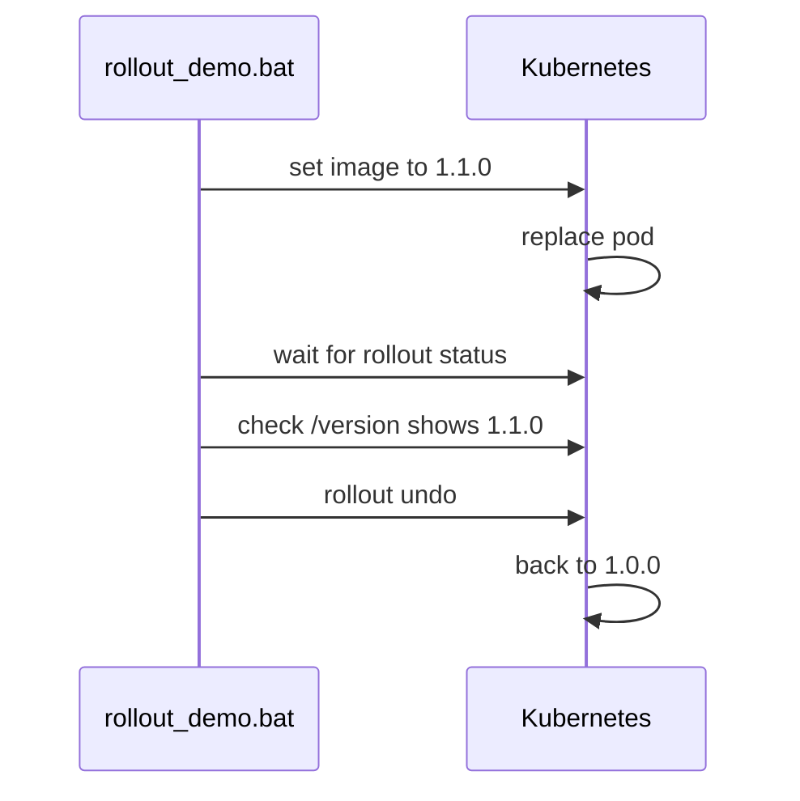

# 06 - Managing Change

## Backward-compatible API evolution
Protobuf rules (for `protos/demo.proto`): add fields with new numbers, add new RPCs or services, never reuse or renumber a field, never change a field's type, deprecate instead of delete. Old clients ignore unknown fields; new servers see defaults for missing ones.

REST (reviews): additive changes only within a version (new optional request fields, new response fields, new endpoints). The contract is `msa/api/reviews-openapi.yaml`; `GET /version` reports the running version.

| Change | Effect |
|---|---|
| Add optional field / endpoint / RPC | Safe |
| Rename a field or route, change a type, make an optional field required | Breaks consumers |
| Remove a field, endpoint or RPC | Breaks consumers |
| Reuse a proto field number | Breaks silently (wrong data) |
| Change the meaning of a value (e.g. rating scale) | Breaks silently |
| Change an event payload shape in `events` | Breaks projection replay; needs versioned event types or upcasting |
| Downtime during a Recreate rollout | Consumers see errors for a short time |

Breaking changes go in a new version (new path prefix or proto package) run side by side until consumers migrate.

## Versioning
Image tags carry the version (1.0.0, 1.1.0) and `/version` shows what is running.

## Rolling update and rollback

Script: `msa/scripts/rollout_demo.bat`, namespace `boutique-staging`, overlay `msa/deploy/overlays/staging`.

**Honest caveat.** reviews-service is single-replica with a SQLite file on a ReadWriteOnce PVC, so it uses the `Recreate` strategy: the old pod stops before the new one starts, giving a brief downtime during both update and rollback. True zero-downtime rolling updates (`RollingUpdate` with several replicas) apply to the stateless Online Boutique services; for reviews they would need an external database. Readiness on `/healthz` keeps traffic away until the new pod is ready, so the outage is roughly pod start-up time. The ResourceQuota and LimitRange from Terraform (`msa/iac/staging`) bound the resources a rollout can use.

## CI as a change gate
`.github/workflows/msa-ci.yaml` builds/tests on changes so a broken change is caught before deployment (see the file for the exact steps).

## How this maps to the syllabus
API versioning and backward compatibility, deployment strategies, rollback, CI/CD, infrastructure as code, evolutionary architecture.

## Evidence in this repo
- `protos/demo.proto`, `msa/api/reviews-openapi.yaml`
- `msa/scripts/rollout_demo.bat`, `msa/deploy/overlays/staging`
- `msa/iac/staging`, `.github/workflows/msa-ci.yaml`
